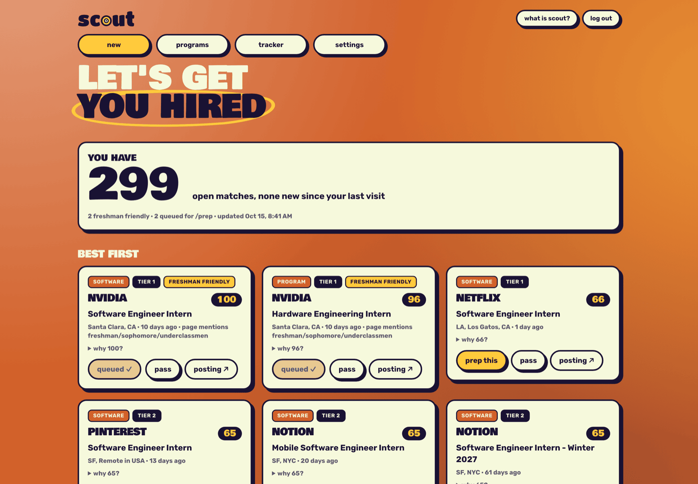
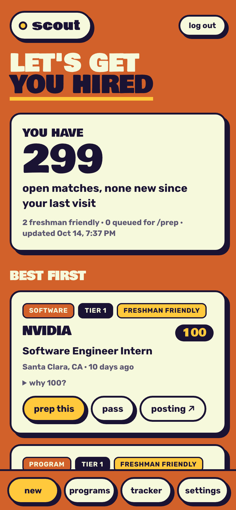
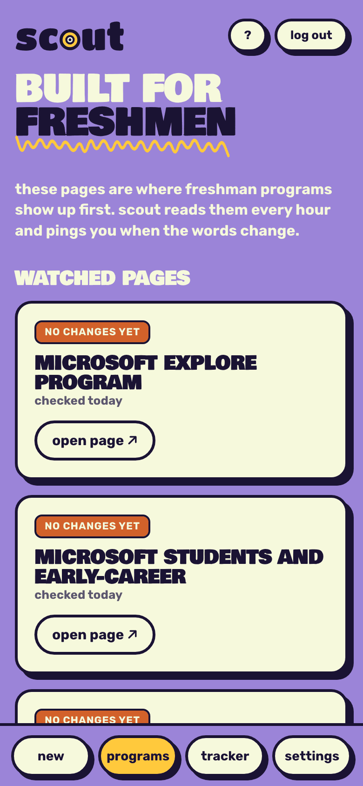
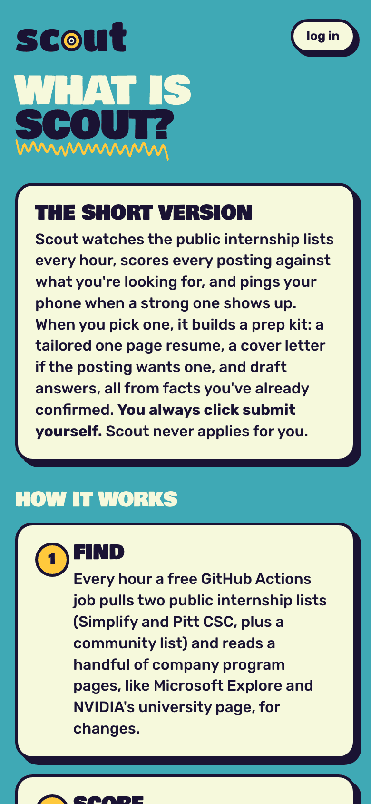

# Scout

**🚧 In development.** It runs every day for one person's internship search; making it work for anyone is the next step ([where this is going](#where-this-is-going)).



<p align="center">
  
  
  
</p>

Scout is an internship radar. About every hour it reads the public internship lists, scores each posting against what you're looking for, and pushes an alert to your phone when a strong match drops. For any posting you pick, it builds a prep kit: a one-page tailored resume, a cover letter if the posting wants one, and draft answers, all from facts you've already confirmed. The public [what is scout?](https://scout-dashboard.jeremysleman.workers.dev/about) page explains it in five steps.

**You always click Submit yourself.** Scout never submits an application, never logs into a job site, never creates accounts, and never solves captchas. It finds, ranks, alerts, and preps.

It costs $0 a month: GitHub Actions (free for public repos), Cloudflare Workers and KV on the free tier, and [ntfy](https://ntfy.sh) for push notifications. The AI parts run inside a Claude Code session you start, so there are no API bills.

## How it works

```
GitHub Actions, every hour              Your Mac, on demand (Claude Code)
  fetch -> normalize -> dedupe             /triage   -> which new matches are worth a kit
  -> filter -> score (0 to 100)            /prep     -> tailored resume, letter, answers
  -> ntfy push (instant / 7 PM digest)     /status   -> move it through the tracker
  -> state saved to the "data" branch
            |
            v
Cloudflare Worker: password-protected dashboard (New, Programs, Tracker, Settings) + KV
```

- **Scoring without AI.** Every posting gets a 0 to 100 score from plain rules in `config/scoring.yaml`: role, company tier, whether it's built for freshmen and sophomores, degree, location, and freshness. Every card shows its math.
- **Eligibility, read from the posting.** Scout reads posting pages on Workday, Google Careers, Greenhouse, Lever, and Ashby for graduation-year or class-year requirements and sinks the ones that rule you out.
- **Program pages watched for changes.** Freshman programs (Microsoft Explore, NVIDIA's university page, and others) often open without appearing in any list, so Scout hashes those pages and pushes the new lines when they change, ignoring rotating job carousels.
- **Prep kits with a second pair of eyes.** A drafter writes from your master profile only; a separate reviewer pass checks every claim against it, plus the posting's must-haves, and lists what you don't have instead of faking it.

## Tech

- **Python 3.12** watcher: `scout/` (listings, matching, scoring, dedupe, eligibility, page watchers, alerts, sync). Standard library plus PyYAML.
- **GitHub Actions** cron and tests (`.github/workflows/`), state committed to a separate `data` branch so `main` holds only code.
- **Cloudflare Worker + KV** dashboard: `worker/src/index.js`, server-rendered pages, HMAC-signed login cookie, every color and size in `worker/src/tokens.css`.
- **HTML + WeasyPrint** for one-page, ATS-checked resume and letter PDFs.
- **Claude Code** for `/triage`, `/prep`, `/interview`, and `/status` (`.claude/commands/`).
- **Tests:** about 150 unit tests on saved fixtures, no network. `python -m unittest discover -s tests -t .`

## Where this is going

The plan is for Scout to work for anyone looking for an internship or a job, whatever their major or career. Already general: scoring and filtering are driven by `config/targets.yaml` and `config/scoring.yaml`, the prep kit works from any master profile, and the dashboard and alerts don't care what the postings are. Still tech-specific: the two data sources are tech internship lists. Next: sources for more fields (starting with the Greenhouse, Lever, and Ashby board APIs, which cover companies in every industry), then a setup command that asks what you're looking for and writes the config for you.

## Make it yours

1. Clone, create a Python 3.12 venv, `pip install -r requirements.txt` (add `requirements-resume.txt` for PDFs).
2. Edit `config/targets.yaml`: roles and the words that identify them, companies by tier, locations, keywords, graduation year.
3. Copy `me.example/` to `me/` (gitignored) and fill in your master profile, then run `/interview` in Claude Code to build your resumes.
4. Set the repo secrets (`NTFY_TOPIC`; plus `SCOUT_URL` and `SCOUT_INGEST_SECRET` if you deploy the dashboard) and enable the workflow.

How every piece runs, with commands: [docs/operations.md](docs/operations.md). Design decisions and why: [docs/decisions.md](docs/decisions.md). Code borrowed from MIT and Apache projects is listed in [THIRD_PARTY_NOTICES.md](THIRD_PARTY_NOTICES.md).

I built it with help from Claude Code. MIT license.
